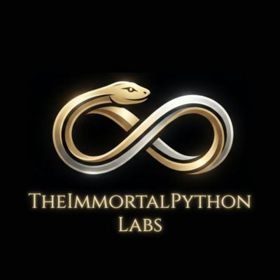

<div align="center">
  
  
  <p><h1>immortal-inference:<br>Non-Stochastic AI Determinism & Logit Containment Engine</h1></p>

  <p>
    <a href="https://github.com/TheImmortalPython/immortal-inference/blob/main/LICENSE"></a>
    <a href="https://github.com/TheImmortalPython/immortal-inference/actions"></a>
    
    <a href="https://github.com/TheImmortalPython/immortal-inference/stargazers">
      
    </a>
  </p>
  
  <p><em>Developed by Joshua St. Germain | TheImmortalPython Labs</em></p>
</div>

---

## 1. Overview

`immortal-inference` is a high-performance, non-stochastic constraint engine engineered to enforce zero-drift linguistic containment and deterministic execution guarantees over generative Large Language Models (LLMs).

By intercepting Hugging Face `LogitsProcessor` pipelines and PyTorch matrix operations in real time, the engine applies dynamic binary distribution masks prior to final token sampling.


```

[ Prompt Context ] ---> [ Logit Interception ] ---> [ Pāṇinian Kāraka Mask ] ---> [ Guaranteed Output ]

```

## 2. Core Architecture

* **Pāṇinian Kāraka Logit Masking:** Maps linguistic dependency structures into mathematical matrices to enforce structural compliance at token step $t+1$.
* **Tensor-Topology Constraint Calculus:** Evaluates the token vocabulary space across a constrained topological subspace, setting non-compliant logits to $-\infty$.
* **Deterministic Execution:** Guarantees absolute structural compliance without output drift, hallucination, or syntax violations.

## 3. Directory Structure


```

immortal-inference/
├── pklm/                  # Core logit processor & PyTorch masking implementation
├── docs/                  # Defensive prior art & architectural specifications
├── examples/              # Example execution scripts
├── README.md              # Project overview, architecture, and Section 13 notice
├── CONTRIBUTING.md        # Contributor guidelines and CLA agreement workflow
├── LICENSE                # GNU Affero General Public License v3.0 (AGPLv3)
├── LICENSE-COMMERCIAL.md  # Commercial License Exception & AGPLv3 Waiver
├── SOVEREIGN_EXCEPTION.md # Public Sector & Critical Infrastructure Safe Harbor
└── PRICING-TIERS.md       # Enterprise Commercial Pricing & Licensing Tiers

```

## 4. Licensing, Author Intent, Community Contributions & Commercial Licensing

This software is released under the **GNU Affero General Public License v3.0 (AGPLv3)**.

### Standard Open-Source Licensing
Under the AGPLv3, you are free to inspect, modify, and redistribute `immortal-inference` provided that all modifications and derivative works remain open-source under the same terms.

### Explicit Author Intent Notice (Section 13)
Pursuant to Section 13 of the AGPLv3 ("Remote Network Interaction"), the author **Joshua St. Germain (TheImmortalPython Labs)** explicitly clarifies that any remote interaction with this software—including API access, web service routing, cloud execution, or integration within an LLM inference pipeline—constitutes interaction over a network. 

Any entity hosting, wrapping, or exposing the capabilities of `immortal-inference` through an API or network protocol MUST make the complete source code of the modified or integrated application available to all users receiving such service.

### Community Contributions & CLA
All community contributions to `immortal-inference` require a signed Contributor License Agreement (CLA). Upon submitting a Pull Request, you will be prompted automatically by our workflow to authorize the agreement. See `CONTRIBUTING.md` for full guidelines.

### Commercial Licensing
To utilize `immortal-inference` in proprietary, closed-source, or SaaS environments without AGPLv3 copyleft obligations, you must acquire a commercial license. Refer to `LICENSE-COMMERCIAL.md` and `PRICING-TIERS.md` for terms.

---

*© TheImmortalPython Labs. All rights reserved.*
